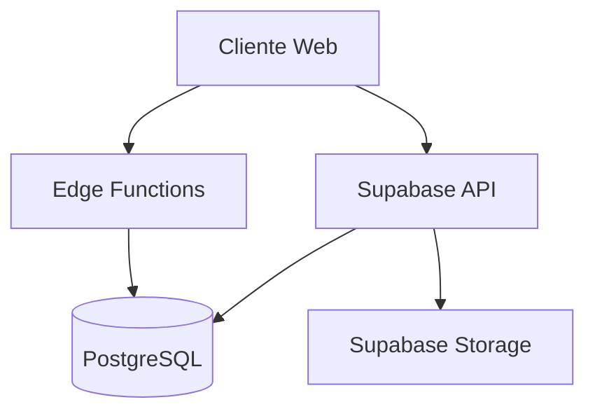

# 🏗️ ARQUITETURA DO SISTEMA - HELLO

## 📋 Visão Geral

Sistema de Contact Center com IA para análise de chamadas, transcrição e análise de sentimentos.

## 🎯 Stack Tecnológica

### Frontend
- **Framework:** React 18 + TypeScript
- **Build:** Vite
- **UI:** Tailwind CSS + shadcn/ui
- **State:** React Query + Zustand
- **Routing:** React Router v6

### Backend
- **Database:** PostgreSQL (Supabase)
- **Auth:** Supabase Auth
- **Storage:** Supabase Storage
- **Edge Functions:** Deno

### DevOps
- **Hosting:** Vercel
- **CI/CD:** GitHub Actions
- **Monitoring:** Sentry
- **Analytics:** PostHog

## 📊 Diagrama de Arquitetura

## 🔐 Segurança

- HTTPS obrigatório
- Row Level Security (RLS)
- JWT Authentication
- Input Sanitization
- CORS configurado
- Rate Limiting

## ⚡ Performance

- Code Splitting
- Lazy Loading
- Image Optimization
- Database Indexes
- API Caching
- CDN (Vercel)

## 📈 Escalabilidade

- Stateless Architecture
- Horizontal Scaling
- Database Connection Pooling
- CDN para assets estáticos
